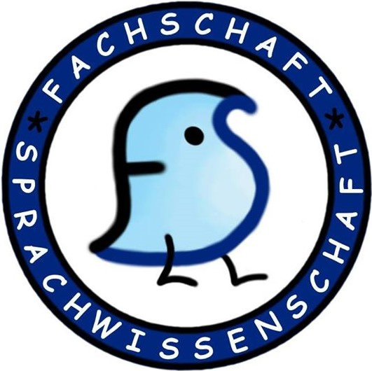

# Date

## Agenda

- X-mas Party logistics
- FS Merch

## Meeting
**Present: Aida, Jay, Akshat, Lidiia, Agnes, Ihor, Şerban**

## X-mas Party

- Announcement depends on room booking
- 11/12 19:00
- Glühwein Pot procurement (2x) on BBP funds or borrow early on, Şerban might find one
- 10/12 Expenditure deadline
- Cafeteria
- Clean-up team (discuss separately)

## VG 0.02 Decorations

- Announcement on the week before
- 16/11
- Bonding activity if a separate meeting
- People can bring materials of people's own
- Ask the building management for permission (16.11-22.11)
- Clean-up

## Secret Santa

- Possible to combine with X-mas party
- Announcement soon
- Think about reassignment strategies and ask Lina
- Ban from FS events those who come without a present

## Fachschaft Merch

- Sticker packs
- T-shirts
- Pins
- Hoodies
- Order procedure
- Likely next year
- IPA

---

Start: 18:35

End: 19:36

Moderator: Aida

Protocol by: Aida

